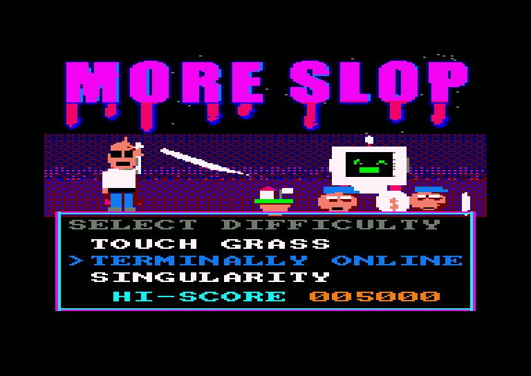
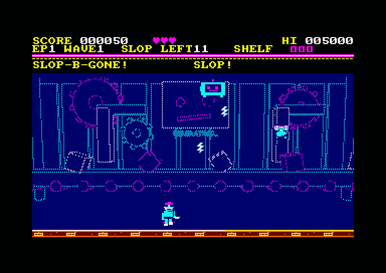
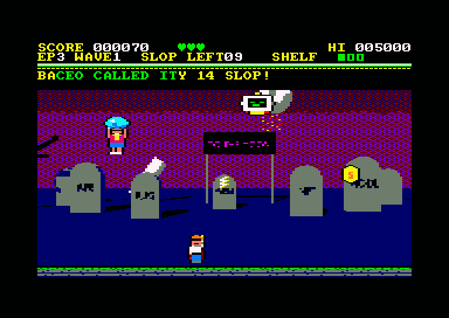
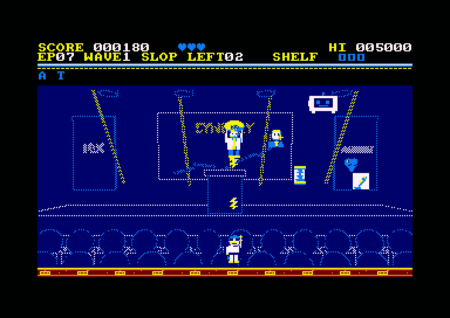
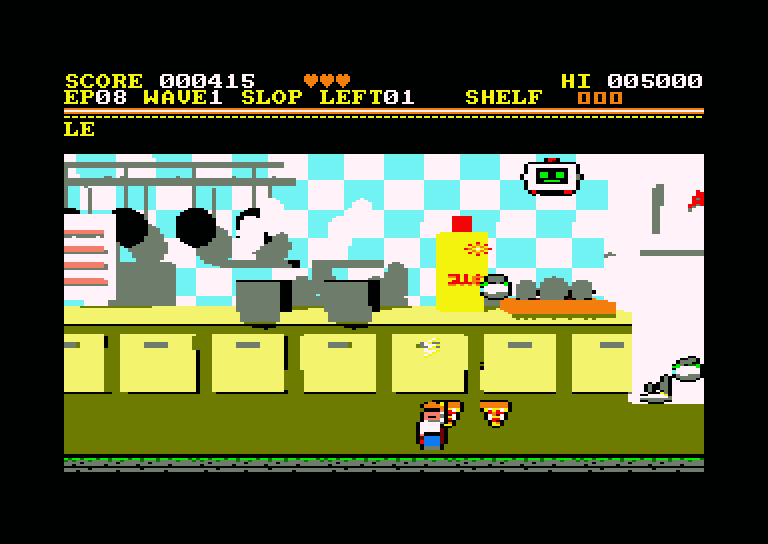

# MORE SLOP

An arcade game for the **Amstrad CPC 6128** about saving civilisation from AI slop.
Themis runs along the bottom of the screen and zaps everything the SlopBot prints
before it lands on the shop shelves: six-fingered hands, three-headed cats,
melting portraits, clickbait, self-help e-books, bored apes, deepfakes, SEO
listicles, chatbot hold music, thought leadership, glue pizza, AI pop songs and,
finally, the SlopBot itself - ten episodes of it. Written in Z80 assembly; graphics modelled in Blender and finished in
Aseprite; music and effects play on the AY from the interrupt.



| | |
|---|---|
|  |  |
|  |  |

## Play

A ready disk image is in the repo: `moreslop.dsk`. To rebuild it:

```bash
make
```

Load `build/moreslop.dsk` in an emulator (WinAPE, RetroVirtualMachine, CPCEC...)
set to a **CPC 6128** and type `RUN"LOADER`. Loading takes about half a minute
behind the loading screen.

| | |
|---|---|
| Left / Right, A / D, joystick | move (hold to run) |
| Space, Return, fire | zap |
| 1 / 2 / 3, Up / Down | difficulty (menu) |
| H | next info page (menu) |
| P | pause |
| Esc | back to the menu |

Three slop items on the shelf cost a life. Six zaps in a row raise the score
multiplier (up to x4).

**Power-ups.** Zap the coffee and the heart: coffee zaps everything on screen,
a heart gives a life. The other four blink as they fall. Zaps go straight through
them, so Themis has to walk under them and catch them. A dropped one costs nothing,
but it's gone. The one that is running shows next to the lives in the HUD.

| | catch it and... |
|---|---|
| Snail | the slop is on dial-up: everything falls at half speed for 10 s |
| Battery | turbo: three zaps in the air instead of two, faster and with no cooldown, for 10 s |
| Ad blocker | the next 3 slop bounce off the shelf (it glows green) |
| Broom | the shelf is swept clean |

**Difficulty**

| | lives | shelf space | speed |
|---|---|---|---|
| TOUCH GRASS | 5 | 5 | gentle |
| TERMINALLY ONLINE | 3 | 3 | normal |
| SINGULARITY | 2 | 3 | fast, crowded |

**Episodes** - three waves each; after the tenth episode the game loops, faster.

1. **The Hallucination Factory** (Mode 1, cyan / magenta / white on dark blue):
   the AI throws pop-ups ("As an AI, I cannot allow the destruction of this
   art") that hide the slop behind them and swallow zaps - three hits close one.
2. **The Clickbait Express** (amber monitor): banners with headlines fly across
   and block zaps; four hits debunk one.
3. **The Crypto Graveyard** (Mode 0, 16 colours): crypto-bros float down on
   bubbles - pop them, or they walk up to Themis and slow him down.
4. **The Deepfake Studio** (green screen on purple): deepfake ads pop up, and
   deepfakes of Themis fall with the slop - zap one and left becomes right.
5. **The SEO Content Farm** (terminal green): listicles and keyword soup that
   split in two when zapped ("part 2 of 47"), under SEO banners.
6. **The Chatbot Helpline** (Mode 0, pastel call centre): robo-phones and
   "typing..." bubbles; Gary, the last human agent, falls too - don't zap Gary.
7. **The Thought Leader Summit** (corporate blue): "Agree?" posts and AI
   headshots; gurus drift down on EGO balloons and slow you with a course.
8. **The AI Kitchen** (Mode 0): glue pizza, rock salad and screw spaghetti that
   split; chef-bots parachute in.
9. **The Slop-Fi Festival** (Mode 0, neon): AI hits on vinyl and cassette,
   playlist pop-ups, and every ten seconds the bass drops - so does the slop.
10. **The Slop Singularity** (red alert data centre): pop-ups, banners and AGI
    evangelists at once, and the last wave ends with a fight against the
    SlopBot itself (twelve zaps).

## How it works

- **25 fps, double buffered.** Two screens (#C000 / #8000). Every sprite drawn
  into a buffer records its rectangle; two frames later those rectangles are
  copied back from a clean copy of the background kept in an extra 64K bank
  (#C4-#C6). The flip waits for the line-34 raster interrupt after the CRTC
  has latched the new address, not for a whole VSYNC.
- **Interrupt.** Six 300 Hz interrupts per frame: the one after VSYNC runs the
  music, sound effects and keyboard scan; the others set palette and mode for
  each band of the screen (Mode 1 HUD over a Mode 0 playfield in episode 3, a
  separate shelf palette, the rainbow logo on the menu).
- **Music.** A small tracker format (`tools/music.py`): patterns with
  transposition, instruments with volume/arpeggio steps, noise drums. Four
  songs (menu, one per episode) and three jingles. Effects take over channel C.
- **Text** uses the CPC's own ROM font, copied at start-up.
- **Memory.** Code, music and variables live at #0040-#3EFF, shared sprites
  and texts at #4000-#67FF (#4000-#7FFF doubles as the window onto the
  extra banks), the loader screen is loaded straight into video memory.
- **Ten episodes in 128K.** Everything that differs per episode - background,
  slop and obstacle sprites, texts, song, palettes - is packed (LZ with an
  optimal parse, `tools/pack_banks.py`) into banks #C5-#C7: 205K of data in
  41K. When an episode starts it is unpacked: the background into bank #C4
  (for repairs) and both screens, the rest into #6800-#7FFF and a slot in
  low memory (`src/episode.asm`).

## Art pipeline

1. `tools/blender/sprites.py`, `tools/blender/scenes.py` (episodes 1-3) and
   `tools/blender/eps.py` (episodes 4-10) build every model and
   scene from primitives in Blender (via the Blender MCP), with two-tone toon
   shaders whose colours are CPC palette colours, and render them at sprite
   size (2:1 pixels for Mode 0). Sources: `art/blender/*.blend`.
2. `tools/aseprite/*.lua` (via the Aseprite MCP) snap the renders to each
   episode's palette, outline them, assemble animation frames, dither the
   backgrounds, and draw the effects and shelves as pixel art. Sources:
   `art/aseprite/*.aseprite`, exports in `art/png/`.
3. `tools/build_assets.py` encodes everything into CPC bytes (masked, trimmed
   sprites; screen images; the LZ-packed menu) and writes the BASIC loader.

## Tests

Headless, on the floooh/chips CPC 6128 emulator in `~/cpcemu`:

```bash
python3 tests/flow.py          # menu, 30 waves, 10 episodes, victory, game over, hi-score
```

```bash
python3 tests/mechanics.py     # deepfakes, Gary, splitting slop, bass drops, the boss
```

```bash
python3 tests/powerups.py      # catching the snail, battery, ad blocker and broom (Mode 1 and Mode 0)
```

```bash
python3 tests/frametimes.py 2  # game-frame lengths in episode 3 (2 = on time)
```

```bash
python3 tests/record_music.py  # AY register log -> build/music/*.wav
```

```bash
python3 tests/video.py         # 4-minute tour of all ten episodes (autopilot) -> build/video/moreslop.mp4
```
